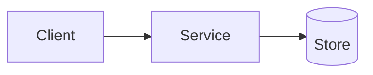

# Presentations

Slide decks written in Markdown with [Slidev](https://sli.dev), built to a static site and deployed to GitHub Pages.

Live: **https://bitpushers.github.io/presentations/**

## Layout

```
decks/<deck-name>/slides.md   the deck — this is the only file you normally edit
decks/<deck-name>/style.css   optional per-deck overrides
decks/<deck-name>/public/     optional static assets (images), reference as /image.png
scripts/build-site.mjs        builds every deck into site/ + generates the index
.github/workflows/deploy.yml  push to main → build → GitHub Pages
```

One directory per deck. Adding a deck means copying `decks/panel-walkthrough/` to a new name and resetting `slides.md` — the build script picks it up automatically and adds it to the index page.

## Writing

```bash
pnpm install
pnpm dev panel-walkthrough  # dev server at http://localhost:3030 with hot reload
pnpm build:site             # build all decks into site/ and sanity-check the output
```

PDF export (needs Chromium, installed on `pnpm install`):

```bash
pnpm -C decks/panel-walkthrough export # → out/panel-walkthrough.pdf
```

Preview the production build locally (the deploy build assumes the `/presentations/` path prefix,
so override it for local serving):

```bash
BASE_PATH="/" pnpm build:site
python3 -m http.server 8000 -d site    # http://localhost:8000/panel-walkthrough/
```

Export uses the `--with-clicks`-less default: each slide is one PDF page, so build animations
are flattened. For an interview or a room with hostile AV, the PDF is the fallback — export it
the night before, not the morning of.

## Slidev basics

- Slides are separated by a line with three dashes: `---`
- YAML frontmatter at the top of the file configures the deck (theme, title, transitions)
- Per-slide frontmatter works too: `layout:`, `class:`, `background:`, `transition:`
- `<!-- comments -->` are stripped from the rendered slide — notes for yourself live there.
  For presenter-view speaker notes, use a trailing `<!-- notes -->` block, which Slidev reads.
- Mermaid diagrams are just fenced blocks:

````markdown

````

- Layouts: `default`, `center`, `cover`, `two-cols`, `image-right`, `quote`, `fact`, `full`
- Presenter view: press `p` in the dev server, or add `/presenter/` to the built URL.
- Overview: `o`. Drawing on a slide: `d`.

## Deploy

Push to `main`. The workflow builds every deck and publishes `site/` to Pages.

Pages is configured for "GitHub Actions" as its source, so no `gh-pages` branch exists and none
should be created.

## Versioning

The repo is the deck. Tag a version before you present (`git tag -a 2026-11-23-panel-walkthrough -m "as presented"`)
if you want the exact slides you stood behind to be recoverable.
