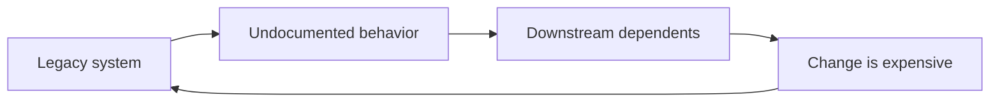
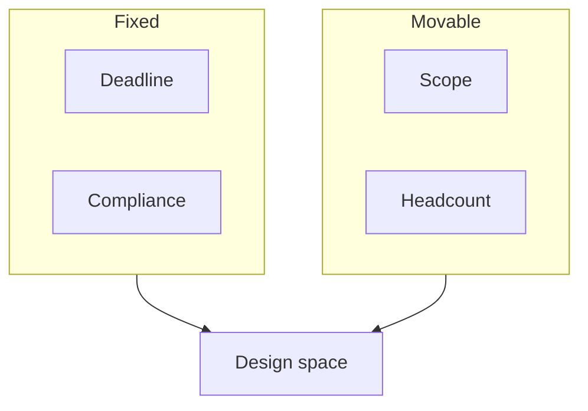
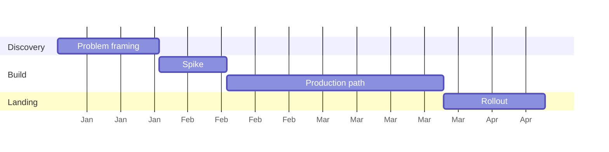
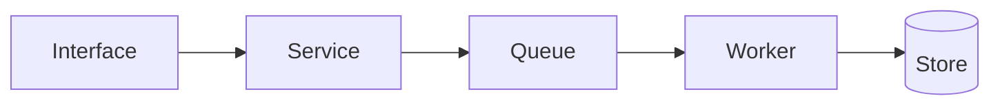

# One project, end to end

## Problem → ownership → tradeoffs → outcome

Panel presentation · 30 minutes · 20 slides

<!--
SLIDE 1 — 30 seconds.
Name, current role, one sentence on what the project was.
Do not read the title card aloud. Establish who you are and start moving.
-->

---

# What I'll cover

**The problem**
 What was broken, and why it mattered

**What I owned**
 Scope, authority, team shape

**The decisions**
 Three forks, and what I gave up at each

**The outcome**
 Measured results, and what I'd redo

<!--
SLIDE 2 — 45 seconds. Signpost the arc, then get out. Reviewers remember structure.
-->

---

# Context

- **Where:** company, team, product surface
- **When:** dates — start and end
- **My title then:** and what it actually meant day to day
- **Team:** headcount, disciplines, who I reported to

<!--
SLIDE 3 — 1 minute. Enough for the panel to place the work. Nothing more.
-->

---

# The problem

> One sentence. If it needs two sentences, it isn't the problem yet.

**Cost of leaving it alone:** money, risk, customer harm, engineer hours — pick the real one

<!--
SLIDE 4 — 1.5 minutes. This is the slide that earns attention. Spend the time.
Strong version: a specific number and who felt the pain.
-->

---

# Why it was hard

Replace the four nodes with the real constraint loop. Name the specific thing that made this a problem rather than a task.

<!--
SLIDE 5 — 1.5 minutes. The loop diagram says "this wasn't laziness, it was a trap" better than prose.
Mermaid syntax lives in a fenced block — edit the labels, keep the shape.
-->

---

# What I owned

### Mine
- Decision A
- Decision B
- People / hiring / mentoring
- The number that moved

### Not mine
- Adjacent team's system
- Budget / headcount approval
- Policy or legal constraint

<!--
SLIDE 6 — 2 minutes. The "not mine" column is the credibility slide.
Panel is testing whether you overclaim. Naming the boundary precisely is the answer.
-->

---

# Starting state

- What existed when I picked it up
- What was already in flight
- The first thing I did in week one

<!--
SLIDE 7 — 1 minute.
-->

---

# Constraint map

The point of this slide: what you could trade and what you could not. Set up the decisions that follow.

<!--
SLIDE 8 — 1.5 minutes.
-->

---

# Decision 1 — the fork

### Chose
Option, in one line

- Why it won
- What it cost

### Rejected
Option, in one line

- Why it lost
- What it would have bought

<!--
SLIDE 9 — 2 minutes. Repeat this shape for slides 10 and 11.
Rule: every "chose" slide names what it cost. A decision with no cost isn't a decision.
-->

---

# Decision 2 — the fork

### Chose
Option, in one line

- Why it won
- What it cost

### Rejected
Option, in one line

- Why it lost

<!--
SLIDE 10 — 2 minutes.
-->

---

# Decision 3 — the fork

### Chose
Option, in one line

- Why it won
- What it cost

### Rejected
Option, in one line

- Why it lost

<!--
SLIDE 11 — 2 minutes.
If a decision was reversed later, say so on that slide, not in the Q&A.
-->

---

# Tradeoff ledger

| Dimension | Bought | Paid |
| --- | --- | --- |
| Speed | what shipped sooner | what got deferred |
| Simplicity | what got easier | what capability was lost |
| Reversibility | what stays cheap to undo | what got locked in |

<!--
SLIDE 12 — 1.5 minutes. The single best slide for a technical panel.
Everything on it should be a sentence you can defend under questioning.
-->

---

# How it actually went

<!--
SLIDE 13 — 1.5 minutes. Plan vs. reality, honestly. The gap is the interesting part; annotate it aloud.
-->

---

# The moment it nearly failed

The problem that surfaced, the day you found out, and what it looked like from inside.

- Signal you ignored or missed
- How it surfaced
- What you changed — in the design, or in how you worked

<!--
SLIDE 14 — 2 minutes. Do not skip this slide. Panels read "nothing went wrong" as either inexperience
or evasion. One real failure, narrated plainly, is worth more than any success metric.
-->

---

# Outcome

—

primary metric

—

secondary metric

—

time or cost saved

Baseline → result, with the measurement window. A number without a baseline is decoration.

<!--
SLIDE 15 — 2 minutes. This is where an interviewer will push hardest. Know the denominator.
-->

---

# What survived me

- System still running, and what it does
- Who picked it up, and what they inherited
- What I'd build differently knowing what I know now

<!--
SLIDE 16 — 1.5 minutes. "Survived me" is a stronger claim than "shipped."
-->

---

# What this taught me

1. A belief you hold about engineering that this project changed.
2. Something about how you work with people, not systems.
3. What you now look for before taking on a project.

<!--
SLIDE 17 — 1.5 minutes. Bridge to "why this is relevant to you" without saying that phrase.
-->

---

# Why it matters here

Two or three sentences connecting the project to the problems this team actually has — the domains, the constraints, the kind of systems they build.

<!--
SLIDE 18 — 1 minute. Do not stretch. If the connection is thin, cut this slide and let the panel draw it.
-->

---

# Questions

Appendix below: extra detail you'd only show if asked.

<!--
SLIDE 19 — hand off. Then stop talking.
-->

---

# Appendix — architecture

<!--
SLIDE 20 — only if asked. Jump here with the slide number, answer, jump back.
Keep the appendix small: two or three slides of real detail you already know cold.
-->
